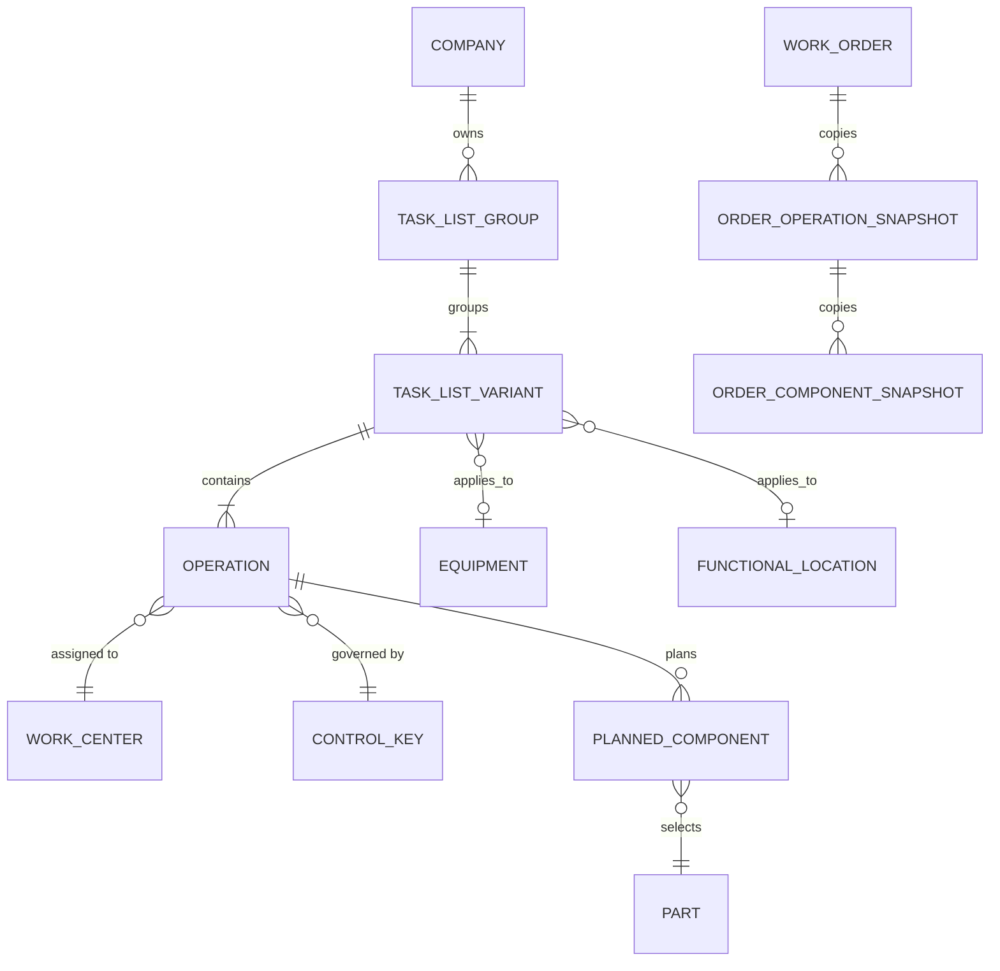

# Modèle métier — listes de tâches de maintenance

**Statut :** proposition métier vérifiée par lecture du code QPM et de la documentation SAP Help.
**Périmètre :** groupe et compteur, objet technique, opérations, main-d’œuvre, centre de travail, composants, création d’un ordre de travail.

## 1. Décisions structurantes

1. Une liste de tâches décrit un travail réutilisable. Elle se compose d’un **groupe**, d’une ou plusieurs **versions/compteurs**, d’opérations ordonnées et de composants planifiés par opération.
2. Une liste est de type `GENERAL`, `EQUIPMENT` ou `FUNCTIONAL_LOCATION`. Les types équipement et emplacement fonctionnel sont liés au bon objet technique; une liste générale est réutilisable.
3. Les identifiants de groupe et de compteur sont générés par QPM. L’utilisateur choisit un groupe existant ou crée un nouveau groupe par une action métier; il ne saisit pas les numéros. Dans SAP, l’affectation dépend du type et du paramétrage : les listes équipement/emplacement sont internes dans la documentation ERP consultée, tandis que les groupes généraux peuvent être internes ou externes. La génération automatique QPM est donc un choix QPM cohérent, pas une affirmation que SAP impose partout l’interne.
4. Un centre de travail doit devenir une donnée de référence, avec valeurs par défaut réutilisables, au lieu d’un champ texte libre. Une valeur par défaut reste modifiable au niveau opération dans le modèle proposé, avec indication de sa provenance.
5. La durée écoulée et le travail de main-d’œuvre sont deux mesures différentes. `durée × nombre de techniciens` n’est qu’une formule valable sous des unités et une convention explicites; elle ne doit pas être présentée comme une formule SAP universelle.
6. Les composants d’une liste sont des **besoins planifiés**. Leur copie dans un ordre ne réserve pas le stock et ne comptabilise pas une sortie de marchandises.
7. À la création de l’ordre depuis la liste, QPM crée un instantané des opérations et composants. Les changements ultérieurs de la liste source ne modifient pas rétroactivement cet ordre.

## 2. Modèle conceptuel

### Entités et cardinalités

- **TaskListGroup** : identité fonctionnelle d’un ensemble de listes similaires, dans une entreprise. Son code est unique dans le périmètre entreprise.
- **TaskListVariant** (actuel `MaintenanceTaskList`) : compteur/version du groupe, type, description, validité, statut et objet technique éventuel. Un groupe peut avoir plusieurs compteurs; un compteur appartient à un groupe.
- **TechnicalObject** : équipement ou emplacement fonctionnel. Une variante typée équipement ou emplacement doit cibler un objet de ce type. Une variante générale n’en cible aucun. QPM doit interdire simultanément équipement et emplacement sur la même variante.
- **Operation** : étape ordonnée, portée par un seul compteur; contient texte, centre de travail, clé de commande, durée, travail standard, effectif et condition d’exploitation.
- **WorkCenter** : référentiel contextualisé par entreprise et site/plant; peut représenter une équipe ou un poste de travail. Il fournit les valeurs par défaut, les capacités et éventuellement les données de planification et de coût.
- **ControlKey** : valeur de configuration qui décrit le traitement de l’opération (par exemple planification, capacité, coût, confirmation, traitement externe). La clé exacte et ses effets dépendent du système/client.
- **PlannedComponent** : lien entre une opération et une pièce du référentiel QPM, avec quantité, unité, emplacement de stock facultatif et estimation de coût facultative.
- **Order snapshots** : copie de planification créée depuis le compteur sélectionné; indépendante de la réservation et de la consommation réelles.

## 3. Mesures et règle de calcul

| Donnée | Sens métier | Règle proposée |
|---|---|---|
| Durée (`duration`) | Temps écoulé planifié pour l’opération | Valeur positive avec unité explicite (par ex. heure). Ce n’est pas automatiquement la somme des heures-personnes. |
| Effectif (`workers`) | Nombre/capacité de personnes affectées simultanément | Le modèle QPM persiste un décimal positif (2 décimales); le champ opération propose actuellement un pas entier, alors que le paramètre par défaut accepte des fractions de 0,25. La règle métier entier vs capacité fractionnaire doit être harmonisée avant de renforcer la validation. |
| Travail planifié (`plannedWork`) | Effort total en unité de travail (ex. heures-personnes) | Calcul automatique seulement si unité de durée et unité de travail sont compatibles et si l’opération est de type main-d’œuvre. Sinon, saisie ou défaut explicite, jamais conversion silencieuse. |
| Capacité du centre | Capacité disponible dans une période/équipe | Calculée à partir du calendrier, des horaires, pauses, équipes et effectif du centre; ne pas la déduire de la seule durée de l’opération. |

QPM calcule maintenant le travail planifié lorsque les unités de durée et de travail sont des unités de temps reconnues (heures, minutes ou secondes), en convertissant le résultat dans l’unité de travail choisie. Ainsi 30 minutes × 2 techniciens donne 1 heure-personne; une unité inconnue ou non temporelle ne déclenche aucune conversion silencieuse. Cela reste une convention de calcul QPM, **pas** une formule SAP universelle : `duration` doit représenter le temps de travail simultané de chaque technicien pour que cette formule soit pertinente. SAP permet des valeurs standard, capacités et formules configurées au centre de travail; la configuration réelle du client fait foi.

## 4. Valeurs auto-remplies et saisies restantes

| Champ | Source par défaut | Intervention attendue |
|---|---|---|
| Groupe et compteur | Séquence QPM sous verrou entreprise/groupe | Aucune saisie du numéro. Choisir un groupe existant ou « nouveau groupe ». |
| Numéro d’opération | Prochain numéro selon les paramètres enregistrés dans Paramètres > Fonctionnalités > Listes de tâches (départ et incrément, défaut 10/10) | Généré et verrouillé sur une nouvelle opération; les numéros existants sont préservés lors des modifications/copies. Le déplacement visuel réordonne les opérations sans renuméroter les références existantes. |
| Type et objet technique | Type choisi, équipement/emplacement du référentiel | Choix contrôlé; filtrer les objets par entreprise, site et permissions. |
| Description de la liste | Dernière description de groupe ou modèle copié | Préremplir, puis laisser modifier; éviter d’écraser une saisie existante. |
| Centre de travail | Défaut du type de maintenance/site ou opération précédente | Choisir dans un référentiel. Suggérer le défaut et rendre visible sa provenance. |
| Clé de commande | Défaut du centre de travail et du profil de liste | Choix dans les clés actives/configurées; ne pas inventer une clé PM globale. |
| Unités | Clé de valeur standard/centre et catalogue d’unités | Préremplir; conversion uniquement si une table de conversion existe. |
| Effectif | Défaut du centre/operation type si configuré; sinon 1 pour compatibilité actuelle | Préremplir et demander confirmation quand le défaut est absent ou ambigu. |
| Travail planifié | Calcul validé par type d’opération et unités compatibles | Calculer et afficher la formule; déverrouiller la valeur si le mode métier l’autorise. |
| Pièce, unité, coût estimé | Référentiel des pièces; unité et coût connus | Sélectionner pièce. Préremplir unité et estimation; la quantité reste propre à l’opération. |
| Magasin/emplacement | Référentiel magasin du site, si configuré | Suggérer selon site et disponibilité; rendre facultatif tant que le référentiel n’est pas en place. |
| Condition d’exploitation | Configuration de conditions d’exploitation | Liste contrôlée et description d’aide, pas texte opaque. Le sens actuel du champ QPM reste à confirmer. |

## 5. Flux de travail cible

1. **Créer/choisir le groupe** : l’utilisateur choisit le type de liste et, si elle est spécifique, l’objet technique. QPM affecte le code de groupe et le compteur selon sa séquence, sans saisie manuelle.
2. **Compléter l’en-tête** : description, validité, centre par défaut et statut brouillon. Copier une liste existante garde la traçabilité de l’origine.
3. **Créer les opérations** : chaque opération reçoit un numéro automatique, un centre de travail suggéré, une clé de commande et les unités par défaut applicables. L’utilisateur ne renseigne que les exceptions.
4. **Affecter les composants** : rechercher la pièce par code/description; unité et coût sont préremplis; quantité planifiée et opération cible sont confirmées.
5. **Réviser et activer** : contrôler validité, liens, unités, doublons, valeurs obligatoires selon la clé de commande, puis passer de brouillon à actif.
6. **Créer l’ordre** : vérifier que la liste est active et valide aujourd’hui, que l’objet technique est compatible et que l’utilisateur est autorisé; copier opérations et composants dans l’ordre.
7. **Exécuter les processus stock séparément** : demande/réservation, disponibilité, sortie et consommation sont gérées par leurs flux dédiés.

## 6. Référentiels à ajouter progressivement

### Priorité 1 — Centres de travail et clés de commande

Le code QPM actuel stocke `workCenter` et `controlKey` en chaînes libres. Il n’existe pas de modèle `WorkCenter` ou `ControlKey` dans le domaine inspecté. Ajouter des référentiels entreprise + site/plant, avec code, libellé, statut, source, dates de validité et paramètres par défaut. Conserver les chaînes historiques comme clés/valeurs non résolues pendant la migration; ne pas les effacer ni supposer qu’elles correspondent à une clé SAP standard.

Les paramètres d’un centre peuvent inclure : catégorie (personne, équipe, équipement/poste), responsable, calendrier/équipe, capacité, unités de valeurs standard, unités/valeurs par défaut et clé de commande par défaut. Les paramètres de clé de commande décrivent les effets activés. Le profil exact doit être défini par les administrateurs QPM; des codes d’exemple SAP tels que `PM01` ou `YBM1` ne sont pas des valeurs globales à imposer.

### Priorité 2 — Unités et lieux de stockage

Introduire un catalogue d’unités et conversions vérifiées. Utiliser l’unité de base de la pièce pour le besoin composant; ne convertir que lorsqu’une conversion existe. Introduire les lieux de stockage sous un site/plant, avec droits et état actif, pour éviter d’entrer des chaînes incompatibles.

### Priorité 3 — Nomenclatures et fonctionnalités avancées

Ajouter une nomenclature d’équipement/emplacement ou d’assemblage pour proposer automatiquement les composants appropriés. L’explosion doit rester une suggestion révisable; un composant ajouté comme exception à la liste ne doit jamais modifier la nomenclature source. Prévoir plus tard les sous-opérations, dépendances, gammes de maintenance, outils/PRT et qualifications, après validation des cas métier et de l’application mobile.

## 7. Contraintes et contrôles

- Unicité entreprise + groupe + compteur et unicité du numéro d’opération dans son compteur.
- Une opération et ses composants ne peuvent jamais être rattachés au mauvais compteur.
- Validité : date de début ≤ date de fin; une liste future ou expirée ne peut être copiée dans un ordre.
- Une liste liée à un objet ne doit pas s’appliquer par erreur à un autre équipement/emplacement.
- Bloquer la suppression physique si une liste est déjà référencée; préférer un indicateur d’archivage/suppression et conserver l’historique.
- Vérifier aussi les références aux plans de maintenance avant suppression. QPM refuse maintenant la suppression si un plan de l’entreprise référence la liste; SAP utilise plutôt un indicateur de suppression puis archivage.
- Contrôler la permission de consulter/modifier les pièces côté serveur; garder les composants existants lors d’une édition sans droit de gestion des pièces.
- N’afficher aucun module ou action d’approvisionnement/stock comme disponible si le flux correspondant n’est pas réellement activé.
- Pour une intégration SAP, utiliser interfaces autorisées (API/OData), identifiant source et règle de propriété des données; jamais d’écriture directe dans la base SAP.

## 8. État actuel QPM et écarts

### Traçabilité au prompt maître QPM CMMS

Les ajouts de cette tranche répondent aux lignes du prompt ci-dessous; ils ne déclarent pas achevées les autres parties du programme.

| Exigence du prompt | Lien avec les changements de cette tranche | État |
|---|---|---|
| **QPM-TL-002 — Group Counter Management** | Groupe/compteur affectés automatiquement côté serveur; sélection et copie d’un compteur du même groupe, en conservant opérations et composants liés. | Renforcé; tests de visibilité/copie existants. |
| **QPM-TL-003 — Task List Operations** | Création automatique du numéro d’opération; valeurs de départ, incrément, effectif et unités par défaut; calcul du travail en unités de temps reconnues. | Implémenté pour les unités H/MIN/S; autres unités à couvrir par un catalogue. |
| **QPM-TL-004 — Assign Materials to Operations** | Les matériaux restent attachés à leur opération et sont copiés comme besoins planifiés; ce travail ne les transforme pas en réservation ou consommation. | Recherche API paginée livrée dans l’étape matériaux; stock réel reste au backlog. |
| **M-02 — Liste utilisable dans un plan PM** | Sélecteur des listes actives filtré par période de validité et objet de référence (général, équipement ou emplacement fonctionnel). | Implémenté; l’association existante est conservée si la liste est introuvable, inactive, incompatible ou si le chargement échoue. Un avertissement permet de retirer le lien explicitement; la panne de localisation ne l’efface jamais. |
| **QPM-CORE — Intégrité des références** | Suppression refusée lorsque la liste est référencée par un OT ou une configuration de plan PM de la même entreprise. | Implémenté et testé; le message utilisateur distingue les deux cas. |
| **QPM-UX-001 — Multi-Step Task List Form** | Paramètres dans la section Fonctionnalités des Paramètres; assistant de gamme et numérotation sans saisie manuelle pour les nouvelles opérations; contrôles tactiles/réactifs sur petit écran. | Renforcé; recette visuelle authentifiée encore requise. |
| **QPM-SEC-001 — Role-Based Access Control** et **QPM-CORE-001 — Standardized Application States** | Paramètres limités aux permissions Settings et au périmètre entreprise; audit de configuration; erreurs de chargement et reprise conservées dans l’interface. | Couvert pour cette configuration et ce flux, pas pour l’application entière. |
| **QPM-INT-001 — Integration Architecture** | Le modèle métier distingue les règles QPM des comportements paramétrables SAP et interdit de considérer l’historique libre comme un référentiel SAP. | Préparation/conception seulement; aucune intégration SAP livrée. |

**Hors de cette tranche :** QPM-EQ-001/002/003 (documents et historique équipement), QPM-FL-001/002 (hiérarchie et fiche emplacement fonctionnel), QPM-NAV-001 à 005 (refonte/navigation dynamique complète), QPM-TL-001 (recherche API des composants) et les modules avancés de QPM-INT-001. Ils restent des éléments distincts du backlog maître.

**Déjà en place dans le code inspecté :** groupes et compteurs attribués par le service, validation des groupes réutilisés, numéros d’opération attribués automatiquement pour les nouvelles opérations selon un départ/incrément par entreprise configuré sous Paramètres > Fonctionnalités > Listes de tâches, matériel relié à l’opération, défaut d’effectif et unités configurables, préremplissage de l’unité/coût depuis la pièce, statut brouillon/actif et dates de validité. Les numéros générés sont verrouillés dans le formulaire; les numéros existants sont conservés lors d’une modification ou copie. La création d’un ordre copie les opérations et composants dans des tables d’instantané et vérifie le statut, les dates, le périmètre société et la correspondance de l’objet technique. Le formulaire permet maintenant de partir d’un compteur du même groupe : il copie ses opérations et composants avec de nouveaux identifiants, en laissant la source intacte, puis QPM attribue le prochain compteur. Le sélecteur appelle un endpoint dédié au groupe exact, sans limite de 100 résultats, et applique les mêmes règles de visibilité propriétaire/permission que la recherche. La copie est désactivée si le rôle ne peut pas consulter les pièces; l’API refuse aussi la copie si certains composants liés sont hors du périmètre de visibilité, afin d’éviter leur omission silencieuse. Les composants sont chargés en différé à la première ouverture de l’étape, puis gardés en mémoire pour éviter les appels répétés; l’échec peut être relancé sans quitter l’étape. Le champ pièce est recherchable par référence, nom ou description, sans tenir compte de la casse; la sélection reste limitée au catalogue existant. L’API suggère, selon le périmètre du rôle et le propriétaire de la liste visible, les valeurs de centres, clés, unités et conditions déjà rencontrées; ces suggestions d’historique ne sont pas encore des référentiels administrables. Pour chaque centre, QPM agrège l’historique visible et ne suggère une valeur que si elle est cohérente. Le centre de l’en-tête est proposé aux opérations et propagé seulement aux opérations vides ou encore héritées de ce centre. En cas d’échec de chargement, le formulaire affiche un avertissement avec relance et autorise toujours la saisie. Les emplacements existants de la fiche pièce sont préremplis sur le composant sélectionné. Le calcul des heures-personnes reconnaît les heures, minutes et secondes côté interface et API; onze tests backend ciblés (8 défauts/suggestions, 3 configuration/permissions) et sept tests UI ciblés couvrent maintenant ces règles.

**Écarts qui augmentent la saisie ou le risque :** les centres, clés, unités et conditions restent des chaînes non contrôlées; les suggestions par entreprise réutilisent l’historique mais ne constituent pas encore des référentiels administrables. Les unités sélectionnées librement ne sont pas converties au-delà des unités de temps reconnues; un catalogue d’unités/conversions reste nécessaire pour d’autres unités. Le sélecteur de composants utilise maintenant une recherche API paginée, avec le cloisonnement entreprise/propriétaire/affectations et le rechargement des pièces déjà sélectionnées. Il manque un référentiel de lieux de stockage et une nomenclature exploitable dans ce flux; le sens métier de `systemCondition` est à préciser. La règle entier/fractionnaire de l’effectif est incohérente entre le champ opération et le défaut dans Settings; à clarifier avant de restreindre les données/API. Les sous-opérations, dépendances, packages et outils ne sont pas représentés par les entités actuelles. La gestion des gammes dans l’application mobile reste absente; le mobile permet actuellement de consulter des plans PM et leurs OT/historiques, pas de créer ou modifier les gammes.

**Choix UI pour la recherche des composants :** un catalogue volumineux ne doit pas être préchargé dans le navigateur. Chaque ligne ouvre maintenant un sélecteur contextualisé : recherche avec seuil minimal, résultats limités/paginés et détails code/nom/description/unité; l’utilisateur sélectionne une pièce unique pour l’opération. La fenêtre est plein écran sur téléphone et conserve le contenu de la gamme en arrière-plan. SAP recommande une aide dédiée pour rechercher parmi plusieurs attributs et les ensembles dépassant 200 valeurs; sa documentation sépare l’expérience téléphone de celle tablette/bureau. [SAP Fiori — Value Help Dialog](https://experience.sap.com/fiori-design-web/v1-34/value-help-dialog/).

**Impact des incréments décrits ici :** `GET /maintenance-task-lists/groups/{groupCode}/counters` applique le cloisonnement par entreprise, le droit de lecture et la visibilité propriétaire. La configuration des défauts et de la numérotation est accessible par `GET/PUT /maintenance-task-lists/configuration`, sous contrôle de permission Settings; sa table Liquibase est nouvelle et ne nécessite pas de migration des listes existantes. Les numéros et composants déjà enregistrés restent inchangés.

### Revue PM et intégrité des listes — 30 octobre 2026

- Le formulaire PM utilise maintenant le catalogue léger `GET /maintenance-task-lists/options`, paginé et limité aux listes actives visibles dans l’entreprise. Il charge les pages par petits lots, puis filtre les listes selon leurs dates de validité et leur type d’objet : générale, équipement du plan ou emplacement du plan/équipement.
- L’échec temporaire de lecture de l’emplacement d’un équipement ne supprime ni ne masque la référence déjà enregistrée. Les listes générales et liées directement à l’équipement restent choisissables; les listes d’emplacement restent non sélectionnables tant que le critère d’emplacement n’est pas vérifié. « Actualiser » relance le chargement du catalogue et de l’emplacement. Les listes incompatibles/expirées sont retirées du plan seulement après vérification réussie.
- Si l’API retourne 403 pour la gamme déjà enregistrée, l’écran signale le manque d’accès; un 404 signale une gamme introuvable. Dans les deux cas le plan conserve son identifiant et propose une action explicite pour retirer le lien. Une erreur réseau/serveur a un message distinct et une relance; elle n’est pas présentée comme un problème de droits.
- La suppression d’une liste référencée est refusée si elle est utilisée par un OT ou par la configuration d’un plan PM de la même entreprise. L’interface fournit un message distinct selon la référence.
- La création/édition d’une liste reste centralisée dans Maintenance préventive → Listes de tâches; le formulaire PM ne contient que la sélection. Les paramètres de numérotation d’opération, effectif et unités restent dans Paramètres → Fonctionnalités → Listes de tâches.
- Validation effectuée : 5 suites frontend PM passées; ESLint et TypeScript passés; 17 tests Java ciblés passés. La compilation frontend de production est en cours. La recette visuelle authentifiée reste non vérifiée dans cette session; l’application mobile consulte les PM et leurs historiques, sans édition de listes de tâches.

## 9. Questions métier à décider avant automatisation complète

1. Dans QPM, `duration` représente-t-elle le temps écoulé de l’opération ou le temps d’un technicien? Proposition : durée écoulée; `plannedWork` représente les heures-personnes.
2. Les valeurs de centre de travail et clés de commande seront-elles administrées par site, ou certaines seront-elles communes à toute l’entreprise?
3. Les centres « équipe » doivent-ils pointer vers les équipes/users déjà définis, ou rester des ressources de planification indépendantes? Proposition : référence facultative vers une équipe, sans assimiler automatiquement chaque équipe à un centre.
4. `systemCondition` signifie-t-il une condition d’exploitation (ex. arrêt/en marche) ou un statut système? Il faut choisir le vocabulaire avant de le transformer en liste contrôlée.
5. Pour une liste générale, l’assemblage/la nomenclature doit-il être requis pour les composants issus d’une BOM? Proposition : facultatif pour les pièces choisies manuellement; requis uniquement pour la suggestion/explosion de nomenclature.

## 10. Sources SAP vérifiées

- [Maintenance Task Lists — SAP S/4HANA](https://help.sap.com/docs/SAP_S4HANA_ON-PREMISE/c00ad2cac7be4ef29a4461ba114e4f91/da84b8535c39b44ce10000000a174cb4.html?locale=en-US&state=PRODUCTION&version=2023.latest) — types, groupes, opérations, composants et usage dans les plans/ordres.
- [Task List Group — SAP ERP PM](https://help.sap.com/docs/SAP_ERP/61f8c51bfee94fa78c8835db685249eb/3065bd534f22b44ce10000000a174cb4.html?version=6.17.latest) et [Number Assignment for Maintenance Task Lists](https://help.sap.com/docs/SAP_ERP/61f8c51bfee94fa78c8835db685249eb/7865bd534f22b44ce10000000a174cb4.html?q=plant+maintenance&version=6.17.latest) — groupe/compteur auto dans le flux décrit; possibilités de numérotation différentes selon type et paramétrage.
- [Default values — SAP S/4HANA](https://help.sap.com/docs/SAP_S4HANA_ON-PREMISE/5e23dc8fe9be4fd496f8ab556667ea05/b973b65334e6b54ce10000000a174cb4.html?locale=en-US&state=PRODUCTION&version=2023.latest), [Work Center](https://help.sap.com/docs/SAP_S4HANA_ON-PREMISE/d74941cf210b44768dc074ce2f243890/d184b8535c39b44ce10000000a174cb4.html) et [Reference Indicator](https://help.sap.com/docs/SAP_S4HANA_ON-PREMISE/d74941cf210b44768dc074ce2f243890/bc73b65334e6b54ce10000000a174cb4.html?locale=en-US&state=PRODUCTION&version=2023.latest) — valeurs centralisées, planification/coût/capacité et comportement des défauts référencés.
- [Control Keys — SAP ERP](https://help.sap.com/docs/SAP_ERP_SPV/f9ecce75e3bc4f94b5ebab70731a9a75/bf73b65334e6b54ce10000000a174cb4.html?locale=en-US&state=PRODUCTION&version=6.18.22) — paramètres de traitement d’opération configurables.
- [Assignment of Material Components — SAP ERP](https://help.sap.com/docs/SAP_ERP/74e3a7c646574f0696d3eee0a1c8241a/0266bd534f22b44ce10000000a174cb4.html?version=6.06.latest) — composants BOM ou stock, plusieurs composants par opération, copie dans l’ordre sans altérer la BOM source.
- [Working with Task Lists — SAP S/4HANA](https://help.sap.com/docs/SAP_S4HANA_ON-PREMISE/efc7922405fd4d56b7571930c5eaa798/13c9b65334e6b54ce10000000a174cb4.html) — sélection/copie et adaptation des opérations lors de la planification d’un ordre.
- [Deleting at Maintenance Task List Level — SAP S/4HANA](https://help.sap.com/docs/SAP_S4HANA_ON-PREMISE/79e86803745943368f3beb4a7d0bca2a/cc65bd534f22b44ce10000000a174cb4.html) — suppression logique par indicateur et archivage.
- [Migration Objects for SAP S/4HANA — Task Lists](https://help.sap.com/doc/69dd0f1ef0034261ab6e617e0b2beb21/1909.002/en-US/MigrationObjects_OP_EN.pdf) — les numéros groupe/compteur/type doivent être fournis dans le fichier de migration; le contrôle de numérotation interne/externe est paramétré.
