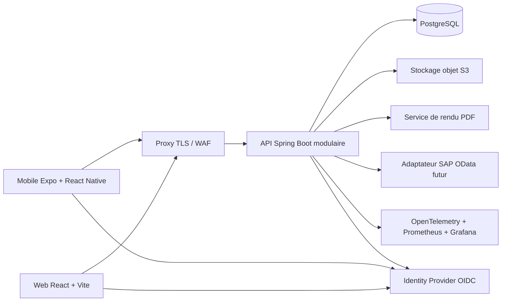

# Stack de référence pour un nouveau projet QPM/EAM

> Proposition pour démarrer un nouveau CMMS/EAM web et mobile. Versions stables observées le **4 novembre 2026**. Avant le premier build, revérifier les derniers correctifs et les compatibilités dans les sources officielles liées ci-dessous. Ne pas utiliser de préversions ou de canary en production.

## Décision d’architecture

Commencer avec un **monolithe modulaire** côté serveur, une base PostgreSQL et des clients web/mobile indépendants. Garder les modules séparés dans le code et les contrats d’API ; ajouter des services distribués seulement lorsqu’un besoin opérationnel le justifie.



## Stack recommandé

| Domaine | Choix de départ | Notes |
|---|---|---|
| Web métier | React **19.3**, TypeScript **6.x**, Vite **8.3**, Material UI **9.x** | SPA responsive. React recommande un framework ou un outil de build maintenu pour les nouveaux projets ; Create React App est déprécié. |
| Routing et données web | React Router stable compatible React 19 ; TanStack Query stable | Garder l’état serveur distinct de l’état d’interface. Générer le client API à partir d’OpenAPI. |
| Formulaires web | React Hook Form et Zod, versions stables compatibles | Validation côté interface et côté API. Le backend reste l’autorité pour les règles métier. |
| API métier | Java **25 LTS**, Spring Boot **4.1.x**, Spring Security, Spring Data JPA | Maven Wrapper **3.9.x** ; gérer les versions de dépendances Spring avec le BOM Spring Boot. Java 25 est une version LTS et Spring Boot 4.1 prend en charge Java jusqu’à 27. |
| Base de données | PostgreSQL **18.6** | Dernier correctif de la branche 18 selon la revue. Utiliser Liquibase pour les changements de schéma. PostgreSQL 19 était en release candidate : ne pas le sélectionner comme base de production. |
| Mobile | Expo SDK **58**, React Native **0.88**, React **19.3** | Les versions sont couplées par Expo ; partir du template SDK 58 et laisser Expo aligner ses modules natifs. Node minimum annoncé par Expo : 22.13.x. |
| Runtime JavaScript | Node.js **26.13 LTS** | Version LTS observée à la date de revue. La figer dans `.nvmrc`, `engines`, CI et images de build ; vérifier les dépendances natives du mobile avant adoption. |
| Authentification | OpenID Connect avec un fournisseur d’identité géré ou Keycloak | OAuth/OIDC pour SSO et clients mobiles. Éviter de créer un système de mots de passe et de tokens maison. Faire appliquer les permissions par l’API. |
| Fichiers et photos | Stockage objet S3 ; MinIO en local si utile | Séparer métadonnées et fichiers. URL signées à durée courte, contrôle d’accès au téléchargement, antivirus si les pièces jointes l’exigent. |
| Documents et PDF | Service de rendu isolé utilisant PDFme ou un moteur évalué pour les besoins | Garder le rendu hors du processus HTTP principal si les rendus sont lourds. Versionner les templates et conserver les documents émis avec leur version de modèle. |
| Jobs différés | Quartz avec stockage PostgreSQL pour une première version | Ajouter une file dédiée uniquement si le volume, la reprise ou le débit le justifient. Utiliser des clés d’idempotence et un outbox transactionnel pour les intégrations. |
| Cache | Aucun cache distribué au départ ; Redis seulement pour un besoin mesuré | Si plusieurs instances API doivent partager des sessions, verrous ou caches, choisir un service distribué et documenter l’invalidation. |
| Proxy et conteneurs | Docker, Docker Compose pour le développement et un pilote ; proxy TLS géré | Construire des images non privilégiées, scanner les images, figer les bases par digest et stocker les secrets hors du dépôt. Évaluer un orchestrateur quand les besoins de disponibilité/charge le demandent. |
| Observabilité | OpenTelemetry, Prometheus, Grafana, Alertmanager et Sentry | Logs JSON avec identifiant de corrélation ; métriques API, JVM, base, tâches de fond et stockage. Définir des alertes actionnables avant la production. |
| CI/CD | GitHub Actions ou CI déjà choisi par l’organisation | Build reproductible, lint, tests, scan sécurité, migration sur base jetable, création d’image signée et déploiement avec retour arrière. |

Sources officielles pour les versions centrales : [React 19.3](https://react.dev/blog/2026/09/09/react-19-3), [Vite versions supportées](https://vite.dev/releases), [Node.js LTS](https://nodejs.org/en/blog/release), [Spring Boot requirements](https://docs.spring.io/spring-boot/system-requirements.html), [Java SE roadmap](https://www.oracle.com/java/technologies/java-se-support-roadmap.html), [PostgreSQL versions/support](https://www.postgresql.org/support/versioning/), [Expo SDK 58](https://expo.dev/changelog/sdk-58), [table de compatibilité Expo/RN/React](https://docs.expo.dev/versions/latest/), [Material UI versions](https://mui.com/material-ui/getting-started/versions/), [TypeScript 6.0](https://www.typescriptlang.org/docs/handbook/release-notes/typescript-6-0.html).

## Organisation du dépôt

```text
apps/
  web/                 # React, Vite, TypeScript
  mobile/              # Expo, React Native
services/
  api/                 # Spring Boot, monolithe modulaire
  pdf-renderer/        # rendu isolé si nécessaire
packages/
  api-client/          # client TypeScript généré depuis OpenAPI
  design-system/       # composants partagés web, si utile
infra/
  compose/             # environnement local
  observability/       # dashboards, règles et configuration
```

Le backend peut être organisé par domaines : `assets`, `maintenance`, `preventive`, `inventory`, `procurement`, `identity`, `reporting` et `integrations`. Chaque domaine possède ses règles et services. Les données restent dans une base PostgreSQL commune au départ, avec des frontières de modules explicites.

## Règles de compatibilité

- **Web :** React 19.3 avec le Vite et les bibliothèques de composants validés pour cette version. Ne pas réintroduire Create React App.
- **Mobile :** Expo SDK 58 fixe la combinaison React Native 0.88/React 19.3. Installer et aligner les modules natifs avec les commandes Expo (`npx expo install`), puis lancer `npx expo-doctor`.
- **TypeScript :** 6.0 est la version stable déclarée à la date de revue, mais c’est aussi une version de transition avec des changements de configuration. Utiliser `strict`, déclarer explicitement les types globaux nécessaires et vérifier les templates/bibliothèques Expo avant de fixer la version dans le mobile.
- **Backend :** Java 25 LTS avec Spring Boot 4.1.x. Garder la version du Maven Wrapper et le BOM dans le dépôt ; ne pas laisser l’image CI choisir une version implicite de Java/Maven.
- **Base :** rester sur PostgreSQL 18.x et appliquer ses correctifs mineurs. Un changement de version majeure nécessite une procédure `pg_upgrade` ou dump/restore et une répétition de restauration avant production.
- **Images :** fixer les versions patch et, pour la production, les digests des images. Les tags flottants comme `latest` ne servent pas aux déploiements reproductibles.

## Principes métier et intégration ERP

- Garder les Work Orders, notifications, plans préventifs, listes de tâches, opérations et composants comme domaines cohérents avec leurs identifiants et statuts stables.
- Distinguer les besoins planifiés des mouvements de stock réellement exécutés : réservation, sortie et consommation sont des opérations séparées.
- Tracer les modifications sensibles par utilisateur, horodatage et motif lorsque nécessaire.
- Préparer une couche d’adaptation SAP OData/API : identifiants externes, propriété de chaque donnée, synchronisation rejouable et gestion des doublons. Ne jamais écrire directement dans la base SAP.
- Documenter les contrats avec OpenAPI et versionner les changements qui touchent les clients mobile/web.

## Stratégie de validation avant première mise en production

1. Générer l’application mobile depuis Expo SDK 58 et confirmer les builds Android/iOS avec les versions natives requises par ce SDK.
2. Vérifier le build web, les tests UI et le mode responsive aux formats téléphone, tablette et bureau.
3. Exécuter les tests API sur PostgreSQL jetable avec migrations Liquibase depuis une base vide et depuis une version précédente.
4. Tester les permissions par rôle et périmètre (site/usine, équipe, centre de travail), y compris les refus d’accès côté API.
5. Valider le cycle métier complet : demande → planification → ordre → opérations/composants → confirmation → clôture ; et demande d’achat → approbation → commande.
6. Tester reprise des jobs, idempotence, sauvegarde/restauration, expiration des liens de fichiers et rendu des documents.
7. Effectuer une recette de charge bornée avant de dimensionner les instances ; suivre latence, erreurs, JVM, connexions DB et délais de jobs.

## Politique de mise à jour

Pour ce nouveau projet, démarrer sur les versions stables recommandées ci-dessus, jamais sur RC, beta ou nightly. Garder les lockfiles, wrapper Maven, versions Expo et digests Docker dans le contrôle de version. Appliquer les correctifs de sécurité rapidement. Regrouper les mises à jour mineures par composant. Traiter toute mise à jour majeure de React Native/Expo, Spring Boot, PostgreSQL ou du schéma comme une migration dédiée avec builds et recette de non-régression.

**Avant le premier commit applicatif**, refaire une vérification de versions officielles, car les lignes stables évoluent ; choisir le dernier correctif pris en charge plutôt que de recopier indéfiniment les numéros de cette proposition.
