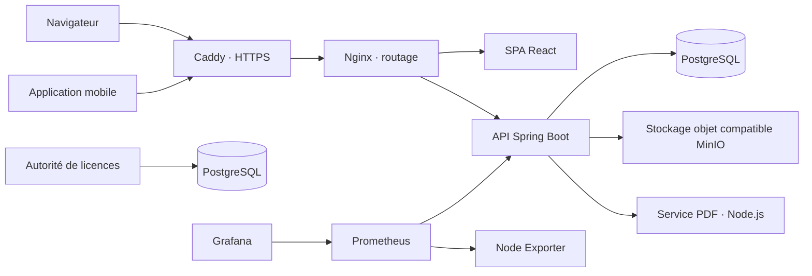

# Stack technique QPM

> Inventaire des versions déclarées dans les manifests du dépôt. Les tags Docker et versions déclarées ne garantissent pas à eux seuls les versions actuellement exécutées en production. Dernière revue : 4 novembre 2026.

## Vue d’ensemble

QPM est un CMMS/EAM composé d’une application web métier, d’une API centrale, d’une application mobile et de services complémentaires pour les documents, les licences et le monitoring.

## Applications et versions

| Composant | Stack déclaré | Références |
|---|---|---|
| Web métier | React 17.0.2, TypeScript 4.7.3, Create React App 5.0.1, `react-app-rewired`, Material UI 5.8.2, Redux Toolkit, React Router | `frontend/package.json`, `frontend/Dockerfile` |
| API QPM | Java 17, Spring Boot 3.5.16, Maven, Spring MVC, Spring Security, Spring Data JPA/Hibernate | `api/pom.xml`, `api/Dockerfile` |
| Base QPM | PostgreSQL 16 (`postgres:16-alpine`) | `docker-compose.yml` |
| Migrations | Liquibase 5.0.3 ; Hibernate valide le schéma au démarrage | `api/pom.xml`, `api/src/main/resources/application.yml` |
| Mobile | React Native 0.79.6, Expo SDK 53, React 19.0.0, TypeScript 5.8.3, Hermes ; nouvelle architecture désactivée | `mobile/package.json`, `mobile/app.config.ts` |
| Android natif | Gradle 8.11.1, Android Gradle Plugin 8.10.1, compile/target SDK 36 | `mobile/android/gradle/wrapper/gradle-wrapper.properties`, `mobile/android/build.gradle`, `mobile/android/gradle.properties` |
| iOS natif | Déploiement minimal iOS 15.1, Hermes, CocoaPods | `mobile/ios/Podfile`, `mobile/ios/Podfile.properties.json` |
| Site public | Next.js 16.1.6, React 18.3.1, TypeScript 5, Material UI 6 ; Next Intl | `home/package.json`, `home/next.config.ts` |
| Déploiement du site public | OpenNext et Wrangler, cible configurée Cloudflare Workers | `home/package.json`, `home/wrangler.jsonc` |
| Rendu PDF | Node.js 22, PDFme 6.2.8 | `pdfme-renderer/package.json`, `pdfme-renderer/Dockerfile` |
| Autorité de licences | Java 17, Spring Boot 3.5.16, JDBC, PostgreSQL 16 | `license-authority/pom.xml`, `license-authority/docker-compose.yml` |

## Infrastructure Compose

Le déploiement principal se trouve dans `docker-compose.yml` :

- **Caddy 2** reçoit le trafic HTTPS et le transmet à Nginx.
- **Nginx 1.27** sert l’interface et route les requêtes vers l’API et les services concernés.
- **PostgreSQL 16** héberge les données QPM.
- **pgsty/silo** fournit une API de stockage objet compatible MinIO.
- **PDFme Renderer** produit les documents PDF.
- **Prometheus 3.13.5**, **Grafana 13.2.4** et **Node Exporter 1.12.1** sont démarrés avec le profil optionnel `monitoring`.
- L’autorité de licences est configurée à part, dans `license-authority/docker-compose.yml`, avec sa propre base PostgreSQL.

Les versions d’images listées sont celles écrites dans Compose. Plusieurs sont des tags et non des digests immuables ; une reconstruction ultérieure peut donc récupérer une image mise à jour sous le même tag.

## Données, sécurité et intégrations

- **Données :** PostgreSQL, JPA/Hibernate, Liquibase ; Quartz utilise le stockage JDBC.
- **Sécurité :** JWT et Spring Security ; le backend prévoit OAuth2 et LDAP. Le frontend inclut le client Auth0.
- **Temps réel :** WebSocket et STOMP.
- **Cache :** Caffeine en mémoire du processus API.
- **Fichiers :** stockage compatible MinIO ; Google Cloud Storage est également pris en charge par configuration.
- **Courriel :** SMTP et SendGrid.
- **PDF :** service Node.js séparé utilisant PDFme.
- **Monitoring :** métriques Micrometer/Prometheus, tableaux Grafana, mesures machine avec Node Exporter, suivi d’erreurs Sentry.
- **Site public :** configuration OpenNext/Wrangler pour Cloudflare.

Il n’y a pas de Redis, Kafka ou RabbitMQ dans le Compose principal. Le cache applicatif est local au processus et Quartz s’appuie sur PostgreSQL.

## Tests et intégration continue déclarés

- **API :** tests Spring Boot, Mockito et Testcontainers PostgreSQL (`api/pom.xml`).
- **Frontend :** scripts de validation et tests ciblés Node.js ; lint ESLint.
- **Mobile :** Jest et scripts de régression (`mobile/package.json`).
- **PDF :** tests Node.js intégrés via `node --test` (`pdfme-renderer/package.json`).
- **CI :** workflows présents sous `.github/workflows/`, notamment `main-ci.yml`, `ios-build.yml` et `mobile-update.yml`.

La présence de ces outils ne signifie pas que les suites ont été exécutées lors de la dernière revue du stack.

## Choix des versions pour un nouveau projet

Pour un nouveau projet, choisir les versions stables et maintenues les plus récentes au moment du démarrage. Vérifier d’abord la compatibilité entre les frameworks, les outils de build, les dépendances natives et l’infrastructure. Éviter les versions expérimentales ou les versions majeures tout juste publiées sans validation de l’écosystème. Verrouiller ensuite les versions exactes dans les manifests et lockfiles afin que les builds restent reproductibles.

Cette règle de départ est différente de la mise à jour de QPM existant : une base neuve peut adopter directement une génération récente, tandis qu’une application en production doit migrer par étapes et préserver la compatibilité.

## Les mises à jour peuvent-elles casser l’application ?

Oui. Le risque dépend de la portée du changement :

| Type de mise à jour | Risque indicatif | Vérifications nécessaires |
|---|---|---|
| Patch d’une bibliothèque isolée | Faible à modéré | Tests du module, compilation et vérification du lockfile |
| Mise à jour mineure du framework ou d’un SDK | Modéré | Notes de version, build complet et parcours métier touchés |
| Mise à jour majeure | Élevé | Guide de migration, adaptation du code et recette de non-régression |
| Expo, React Native, React ou dépendances natives Android/iOS | Élevé | Compatibilité croisée, prébuild natif, builds Android/iOS et validation sur appareils |
| PostgreSQL, Liquibase ou Spring Boot | Élevé | Copie de sauvegarde, migration testée sur copie, compatibilité du schéma et possibilité de retour arrière |
| Image de base ou tag Docker | Variable | Build reproductible, démarrage des services et contrôle des logs |

Les trois interfaces ont des générations React différentes (17 pour le web métier, 18 pour le site, 19 pour le mobile). Elles doivent être mises à jour séparément, en conservant les versions compatibles propres à chaque application. Une mise à jour de React du web ne doit pas être appliquée automatiquement au mobile.

## Procédure recommandée pour une mise à jour

1. **Établir un état de référence.** Noter la version de départ, la branche, les commits concernés et les résultats des builds/tests existants.
2. **Lire les notes de migration.** Vérifier les prérequis de Node, Java, Gradle, Expo, React Native, PostgreSQL et des bibliothèques liées.
3. **Mettre à jour un seul ensemble cohérent à la fois.** Garder React, React Native et Expo dans leurs combinaisons prises en charge ; ne pas mélanger avec une migration sans rapport.
4. **Verrouiller les dépendances.** Mettre à jour le manifeste et le lockfile ensemble. Éviter une installation qui ignore les conflits peer sans examiner ceux-ci.
5. **Examiner les migrations de base.** Utiliser Liquibase avec des changements additifs lorsque possible ; valider sur une copie de base et préparer la restauration avant une migration risquée.
6. **Construire les livrables touchés.** SPA web, image API, APK Android, IPA iOS ou site public selon le changement.
7. **Valider les parcours liés.** Authentification, Work Orders, PM/Task Lists, Procurement, pièces jointes, documents PDF, notifications, fonctionnement mobile et affichage responsive.
8. **Déployer progressivement et surveiller.** Contrôler les logs, les erreurs API, les métriques, les performances et les migrations ; garder la version précédente disponible pour revenir en arrière.

Ne pas mettre à jour toutes les dépendances en bloc sur une branche de production. Pour les changements majeurs ou natifs, prévoir une branche dédiée et une recette Android/iOS/Web avant déploiement.
