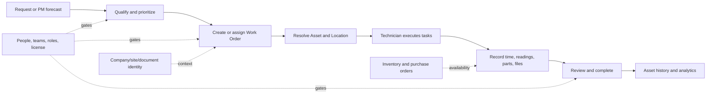

# Business workflow assessment

This is a code-path assessment, not proof that current API calls complete. The primary product workflow comes from `docs/ORIENTATION-PRODUIT.md`: report or plan work → qualify/assign → execute → record tasks/time/parts → authorize close → update asset history.

| Workflow | Entry and navigation | Actions/state transitions present in source | API/state/permissions | UX risk and evidence status |
|---|---|---|---|---|
| Login/session | Web `/account/login` and mobile auth navigator → root/app tabs. | Sign in, verify, register/recover; access/refresh token handling. | Web Fetch + localStorage; native `auth/signin`, `auth/refresh`, `instance-config` via Fetch/AsyncStorage. Protected routing in `frontend/src/router/index.tsx` and auth navigation in `mobile/navigation/index.tsx`. | Needs live session/expired-token/network test. Never use production credentials in design research. |
| Work request | Web sidebar Requests; native Requests tab/More; list → create/edit/detail → approval/rejection/order relation. | Request status and approved/rejected actions; creation/update; navigation to related WO. | `mobile/slices/request.ts`: `POST requests/search`, `GET requests/{id}`, `POST requests`, `PATCH requests/{id}`, `DELETE requests/{id}`; approval/rejection also patches related WO. `PermissionEntity.REQUESTS`; WO creation additionally checks `WORK_ORDERS` (`Requests/RequestDetails.tsx`). | Check no optimistic success on failure, empty list, requester scope, and reason validation. |
| Work order planning | Web root Work Orders → list/detail/create; mobile center Create / WO list → detail. | Create, assign, priority, due date, asset/location, tasks, PM relation; edits and status. | `mobile/slices/workOrder.ts`: `POST work-orders/search`, `GET work-orders/{id}`, `POST work-orders`, `PATCH work-orders/{id}`, `DELETE work-orders/{id}`, `POST work-orders/events`; permissions/feature gates in `useAuth`. | Measure field burden, assignment defaults, route back, duplicate submission and saved-state confirmation. |
| Work order execution | Web WO detail tabs/sections; mobile WODetails → Tasks, time, costs, parts, files/comments, complete modal. | Task completion, log labor/time and cost, consume parts, attach evidence, status completion/signature. | Work order calls above plus task/labor/part/file slices; relative endpoints in `mobile/slices/{workOrder,partQuantity}.ts` and upload paths via `mobile/utils/api.ts`. Exact upload calls need action-level trace. | Most critical field journey; test weak connection, interruption/resume, permission denial and confirm close. |
| Asset/location | Sidebar Assets/Locations; WO/PM selectors; native lists/scan/selectors → detail tabs. | Browse hierarchy, create/edit, relate equipment/location, view WO/files/parts/meters/downtime/analytics. | Native `asset.ts`: `POST assets/search`, `GET assets/{id}`, `POST assets`, `PATCH/DELETE assets/{id}`, NFC/barcode, related WO/location/part reads. Native `location.ts`: search, detail, create/edit/delete, children. Fine-grained `ASSETS`/`LOCATIONS` checks; asset detail also checks WO/parts/PM/files/meters. | Web has asset 360-like tab foundation; validate hierarchy clarity, search, source of parent-child relationships. |
| Preventive maintenance | Web PM list → create/edit with schedule, task/checklist, meter/cycle strategy → preview → detail/call register/WO. Native PM list/details. | Calendar and meter plan configuration, forecasts, calls, work order generation/history. | Native `preventiveMaintenance.ts`: `POST preventive-maintenances/search`, `GET preventive-maintenances/{id}`, POST/PATCH/delete; linked schedule update uses schedule slice. Permission `PREVENTIVE_MAINTENANCES`, plus subscription/license features. | Highest configuration complexity; distinguish forecast from persisted call or generated WO. Manual scenarios in `docs/TESTS-PM-STRATEGIES-MULTICOMPTEURS.md`. |
| Meter readings | Asset/meter detail or WO execution → add reading → history/threshold/cycle register. | Numeric reading and date, trigger/cycle evaluation. | Native `meter.ts`: search/detail/create/edit/delete and `meters/asset/{id}`; `reading.ts`: `GET readings/meter/{id}`, `POST readings`, patch/delete. Meter permission and feature gates. | Validate units/precision/timezone, monotonicity, warnings, offline retry and linked WO. |
| Inspections/checklists | Settings → checklists library; PM or WO task selection; native selector/task execution. | Create reusable lists, ordered operations, associate with plan/WO, complete operation. | Checklist/task API slices; settings and relevant create/edit permissions. | Confirm whether save produces library template and whether reused tasks remain traceable. |
| Inventory/spare parts | Inventory parts/sets; part detail → asset/WO links; WO consumes parts; purchase orders. | CRUD, quantities, associations and replenishment/purchase. | Native `part.ts`: `POST parts/search`, get/create/edit/delete; `partQuantity.ts` reads/patches WO and PO quantities; entitlement and `PARTS_AND_MULTIPARTS` permission. | Validate stock decrement, empty/low-stock feedback and responsive table/list. End-to-end procurement/receipt is not verified. |
| Procurement | Purchase Orders route list/detail/create; vendor selection. | Create and manage PO records. | Native `purchaseOrder.ts`: `POST purchase-orders/search`, `GET purchase-orders/{id}`, POST/PATCH/DELETE; `PURCHASE_ORDERS` permission/feature. | Receiving/goods receipt route was not identified from route inventory; do not imply complete procure-to-receive workflow. |
| People/teams/partners | People & Teams, Vendors & Customers; invite/edit/detail. | Invite user, update roles/team; edit partner data. | Native `user.ts` and `team.ts`: search, detail, create, patch, delete; separate vendor/customer screens. Role/seat/license controls apply. | Critical permission/seat warning UX; verify action visibility vs backend refusal. |
| Analytics | Statistics sidebar → reports; filters/date ranges; exports. | Render WO/asset/parts/request reports, change date filter, retry/export. | analytics APIs, access checks, global API error handling. | Historical 13-widget `null`/403 defect; live behavior awaits stable backend. |
| Company/admin/licensing | Settings, company profile tabs and license screen, integrations/imports. | Edit company/legal/site data, review history, activate license, configure roles/settings. | settings/company/site/document/license APIs; ownership/SETTINGS permissions, tenant-company scope. | Sensitive actions need clear permissions and audit feedback; do not change business rules in UI scope. |

## Primary workflow dependency graph

## Critical dependencies for redesign

- A WO depends on permission, subscription/license, asset/location context, optional checklist/tasks, assignment, and work-order configuration. UI simplification cannot discard any of those contracts.
- Completion may depend on required task fields, signature/approval configuration, time/part entry, or role. Map feature/role matrix before prototyping.
- PM forecast is not the same as a persisted call or generated WO; keep these states and timestamps distinct.
- Analytics relies on authorization scope and date semantics; present data errors separately from valid empty results.
- Official document snapshots rely on company/site identity at issuance; redesign must preserve immutable issued artifacts and auditing.
- Mobile is network-dependent for most mutations. Redux persistence is present, but an offline mutation queue is not proven.
