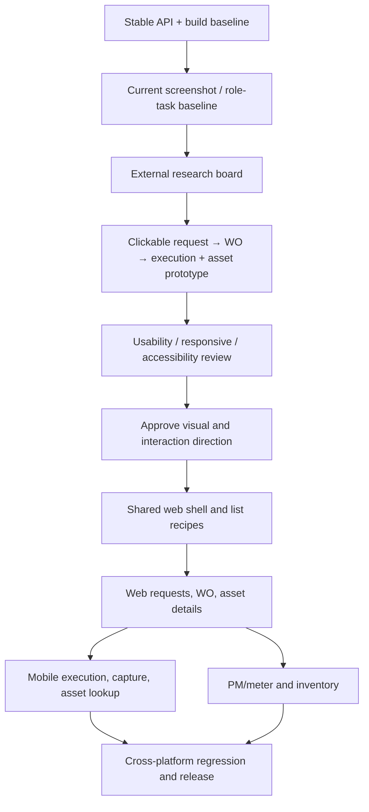

# Design-to-implementation dependency map

This maps future work to current modules/components. It is not authorization to implement or change APIs. Status and workflow semantics remain owned by current backend/domain services.

| Work package | Screen IDs | Existing dependencies to map/reuse | Prototype/implementation prerequisites | Risk / gate |
|---|---|---|---|---|
| D0 API/runtime baseline | All authenticated | API health, current source/deployment, existing role test accounts | Resolve known schema mismatch and 502 outside UI redesign; obtain stable UI and mobile build/version. | P0 blocker: visual testing against unavailable API would misattribute failures. |
| D1 Research baseline | All; especially WEB-054/055, MOB-002/073 | Assessment JSON, current 2026-10-03 screenshots, `docs/design.md`, product workflow docs | Obtain current screenshots at desktop/tablet/phone and native Android/iOS; map current roles/actions. | Existing screenshots are dated; no assumption current issue persists. |
| D2 Web shell prototype | All Web, WEB-045/046/054/055 and admin | `ExtendedSidebarLayout`, header/sidebar/menu, `SidebarMenu/items.ts`, route gate, MUI themes | Role/task tests; route list grouped without changing route paths, `can()` checks or license filters. | Hiding a link visually must never weaken API authorization or create dead links. |
| D3 Shared list/table recipes | WEB-043–060, WEB-077–084, WEB-095–103 | `CustomDatagrid2`, `TableCustomized`, MUI DataGrid, TanStack uses; filter/search/pagination state | Behavior parity inventory: sort/filter/page/selection/export/row action/empty/error. Prototype keyboard sort. | Consolidation can alter server paging, column semantics and current user habits. Keep specialized grids where needed. |
| D4 WO/request UX | WEB-045/046/054/055; MOB-002/003/005–007/021/022/044/048/065/073 | Web Requests/WO components; mobile request/workOrder slices and form/detail screens; task/time/cost/file components | Confirm supported action endpoints, role matrix, current transitions, idempotency/double-submit and save feedback. | Preserve API payloads and status/permission/entitlement behavior. No invented inline/bulk transitions. |
| D5 Asset 360 | WEB-052/053/060/062–069; MOB-008/009/029–034/045/057/058 | Asset/location screens/tabs, NFC/barcode scan, selectors, API slices | Check actual relation fields, query cost, available counts, permissions for each related tab. | Do not present missing/unloaded data as zero; hierarchy/site semantics must remain true. |
| D6 PM and meter UX | WEB-043/044/047/048; MOB-011/014–018 | Formik/Yup, PM editor, schedule/cycle forecast, reading/meter slices and call register | Re-run PM test guide; record saved vs forecast vs call vs generated WO; validate date/unit/timezone. | High business-rule sensitivity. Changes to OR/AND, frequency or generator need separate approval. |
| D7 Native field ergonomics | MOB-002/003/005/007/029/030/045/048/073 | Paper theme, `BasicField`, `NumberInput`, `ListField`, action sheets, file/photo/camera/NFC components; AsyncStorage store/API | Android/iOS build on real devices; large text/screen reader, weak network, permission/upload handling. | Persisted Redux is not proof of offline mutation queue; don't design false sync promise. |
| D8 Analytics/admin/design tokens | WEB-002/007–042/095–106; MOB-040–043 | ApexCharts, company profile, licensing, settings, MUI/Paper themes, async wrappers | Revalidate earlier analytics `null` widget defect; preserve metrics/entitlements/audit and document snapshots. | Do analytics after backend health. Company/legal and license data are security-sensitive. |

## Dependency order

## Phase exit conditions

- **Prototype approval:** target roles, expected actions, states, component disposition, responsive adaptation, API/permission invariants and research references are documented.
- **First implementation slice:** before/after task evidence, React/MUI and Expo/Paper compatibility, tests, desktop and device checks. No new dependencies absent a demonstrated need.
- **Expansion:** no blocking regression in Request→WO→execution→asset history; then PM and Materials slices can follow with business-owner review.
- **Out of scope without separate approval:** database/API contract, permission model, workflow state, license behavior, offline write synchronization, new mobile screens or AI features.

## Risks to carry

The supplied last deployment logs showed Hibernate validation failures (`request.site_id`, `work_order_aud.site_mod`, `company_configuration_audit_seq`) despite Liquibase claiming no changesets, followed by nginx 502. This is an operational prerequisite, not a styling issue. Other risks are layout regression across 106 Web destinations, different Android/iOS safe areas, tab overflow in long French labels, large data tables, historical screenshots not matching current version, and user permissions varying by company/license role. Label all of these pending until verified.
