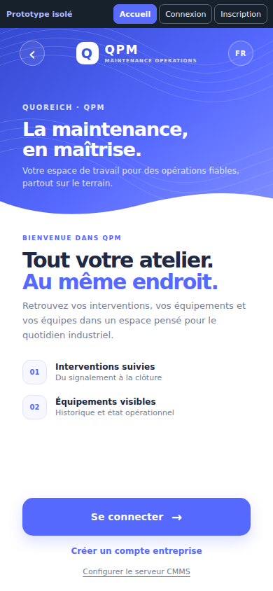
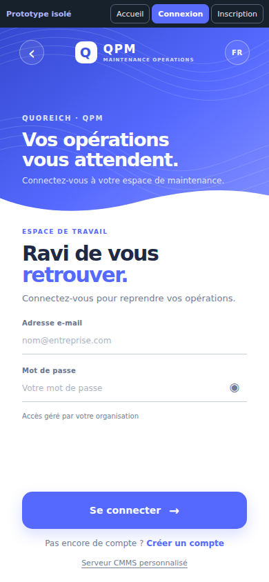
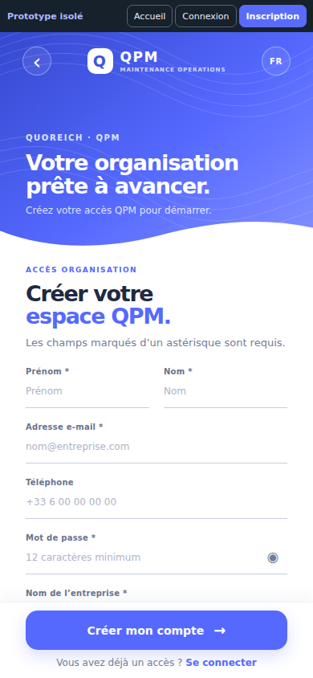
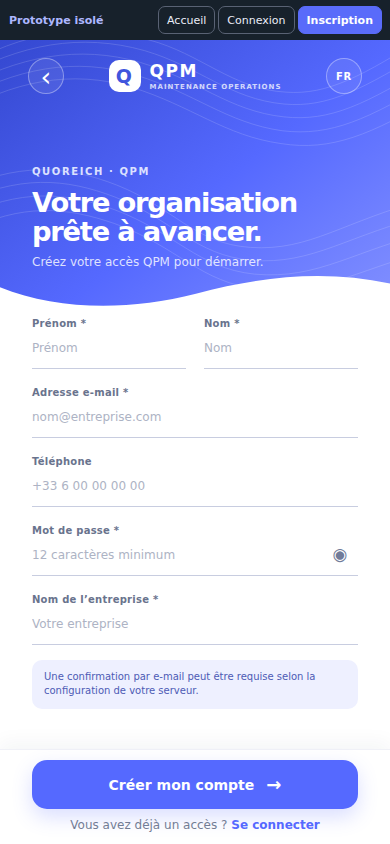
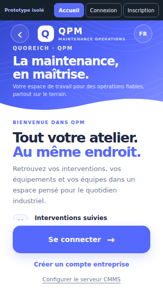
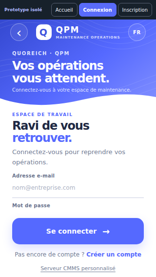
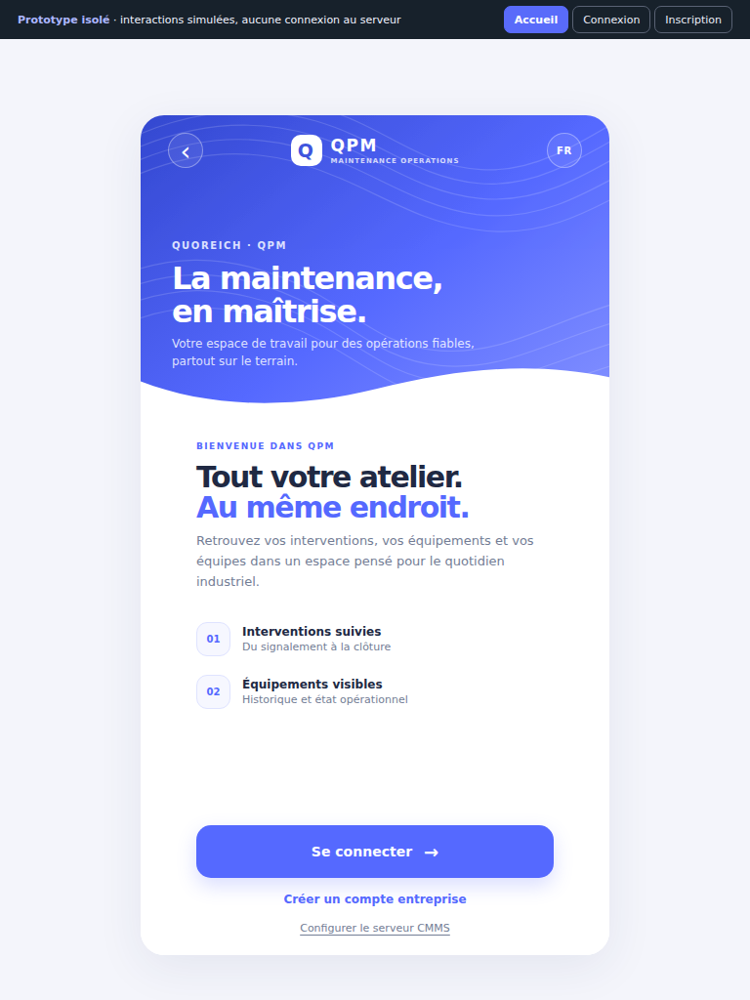

# Prototype mobile — Authentification QPM

Ouvrir `index.html` directement dans un navigateur. Les trois vues sont navigables depuis le bandeau de revue ou leurs liens secondaires. Les contrôles de mot de passe, la validation locale, l’état occupé et les retours de démonstration sont simulés ; le prototype n’appelle aucun endpoint et ne crée aucun compte.

## Vérification du flux réel

- L’application affiche `LoginScreen` comme première route de l’`AuthNavigator` (`mobile/navigation/index.tsx`). `WelcomeScreen` existe, mais n’est pas enregistré dans cet authentificateur.
- Connexion : `LoginScreen` utilise Formik/Yup puis `useAuth().login`; le service appelle `auth/signin` ou `auth/signin-ldap` (`mobile/contexts/AuthContext.tsx`). L’inscription est masquée sur l’écran de connexion quand `ldapEnabled` est actif.
- Inscription : les champs actuels sont prénom, nom, e-mail, téléphone, mot de passe (12 caractères minimum) et nom de société (`mobile/screens/auth/RegisterScreen.tsx`). Le service envoie `auth/signup`; en environnement non local, l’écran dirige ensuite vers `VerifyScreen`.
- La troisième vue représente donc l’inscription actuelle avec son état de confirmation e-mail. Elle ne change pas les règles d’accès, les rôles, l’API, ni la disponibilité du registre public.

## Comparaison — composition demandée → prototype QPM

Les trois captures de référence mentionnées dans la demande ne sont pas disponibles dans les pièces jointes visibles ni dans les fichiers du dépôt. La comparaison reste donc provisoire, fondée uniquement sur la description écrite :

| Pattern demandé                                  | Adaptation dans le prototype                                                       |
| ------------------------------------------------ | ---------------------------------------------------------------------------------- |
| Grand bandeau décoratif et lignes topographiques | Bandeau haut bleu QPM, motif de courbes en trame discrète, wordmark centré         |
| Vague blanche organique                          | Séparateur SVG fluide superposé au bas du bandeau                                  |
| Texte et formulaire verticalisés                 | Titres alignés à gauche, espace blanc, champs sous-lignés                          |
| Visibilité du mot de passe                       | Contrôle accessible sur Connexion et Inscription                                   |
| Action principale ancrée en bas                  | Bouton pleine largeur en pied d’écran avec marge de zone sûre                      |
| Liens secondaires compacts                       | Accès entre connexion/inscription et configuration serveur                         |
| Variantes de petite taille                       | Mise en page fluide, contenu défilable pour l’inscription, zone d’action conservée |

Une comparaison visuelle pixel-par-pixel attend les captures originales. Les références ne sont pas recréées artificiellement.

## Écrans et états

- `welcome` : accueil QPM, navigation vers connexion et inscription, accès au parcours serveur existant.
- `signin` : e-mail et mot de passe, visibilité, validations, mot de passe oublié informatif et confirmation de connexion simulée.
- `signup` : champs conformes à l’inscription courante, validations, confirmation simulée mentionnant la vérification e-mail.
- États d’erreur de saisie, traitement, succès simulé et focus clavier visibles. Une panne API et un refus de permission ne sont pas simulés, car aucune requête/permission réelle ne s’exécute dans le prototype.

## Tester avec Expo

Une version React Native du prototype est accessible dans l’application en mode développement uniquement : `mobile/screens/auth/AuthenticationPrototypeScreen.tsx`. Au lancement en mode développement, elle s’ouvre avant la connexion réelle. Le bandeau « Connexion actuelle » ouvre `LoginScreen` ; le bouton de configuration ouvre le parcours `CustomServer` déjà existant.

```bash
cd mobile
npm run start:lan -- --clear
```

Ouvrir le projet avec la build de développement QPM installée sur le téléphone. La route `AuthPrototype` est conditionnée par `__DEV__` et l’écran de démarrage de production reste `Login`. Les soumissions du prototype valident localement les champs puis affichent un retour simulé : elles n’appellent ni `useAuth`, ni endpoint, et ne créent aucun compte.

## Captures navigateur du prototype

Ces captures sont des rendus Chromium du prototype HTML/CSS. Elles documentent la composition et les formats testés ; elles ne sont pas des captures de l’écran React Native sur appareil.

| Écran / format | Capture |
| --- | --- |
| Accueil, téléphone 390 × 844 |  |
| Connexion, téléphone 390 × 844 |  |
| Inscription, téléphone 390 × 844 |  |
| Inscription, bas du formulaire défilé |  |
| Accueil, téléphone compact |  |
| Connexion, téléphone compact |  |
| Accueil, tablette 768 × 1024 |  |

## Impact technique

Le prototype React Native ajoute une route `AuthPrototype` de développement et un écran autonome. L’authentification actuelle, ses contrats, le paramètre LDAP, le lien `CustomServer`, le workflow `Verify`, les permissions et l’inscription configurée côté serveur restent inchangés. Avant de reprendre ces motifs dans les vrais écrans, conserver Formik/Yup, `useAuth`, les textes localisés et les états réels de réponse API. La comparaison exacte aux références visuelles et des captures natives Android/iOS restent à faire lorsque les images de référence seront disponibles et après revue sur appareil.
